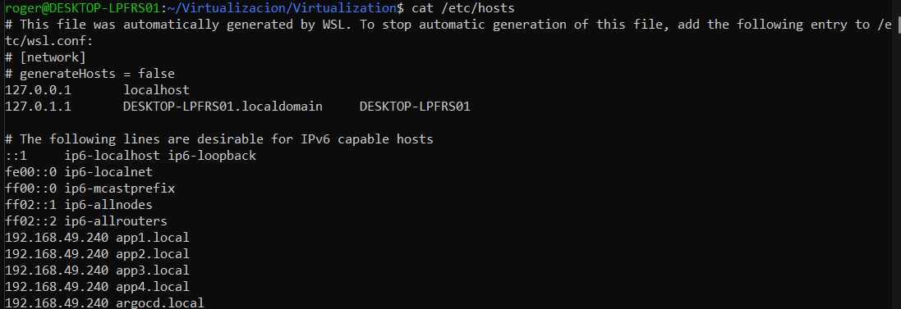
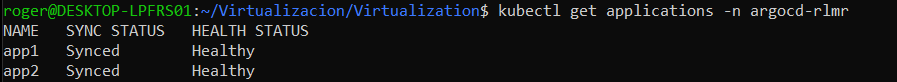
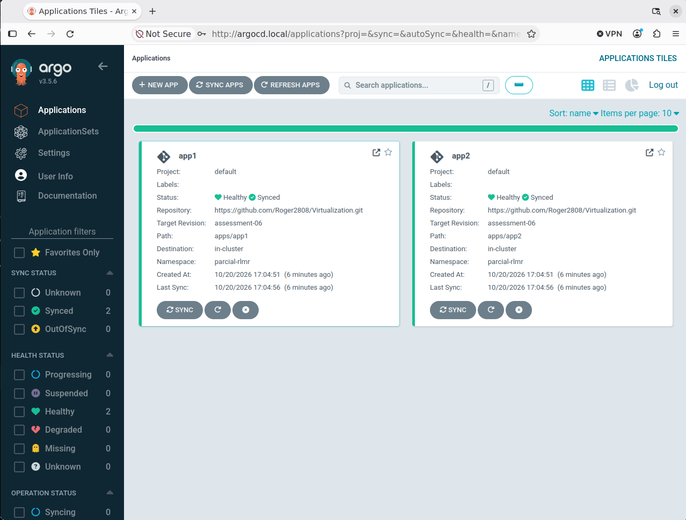
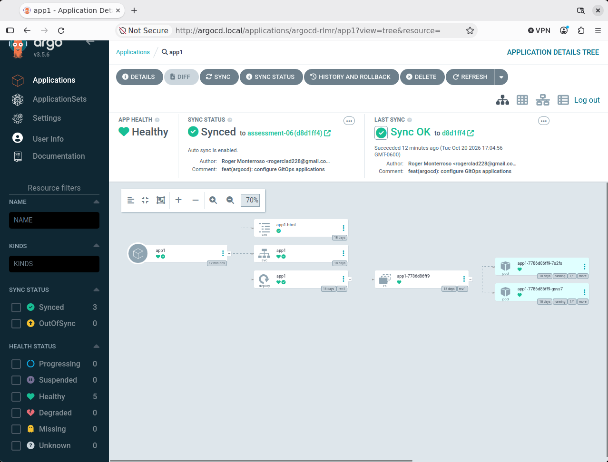
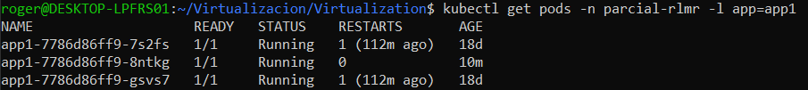
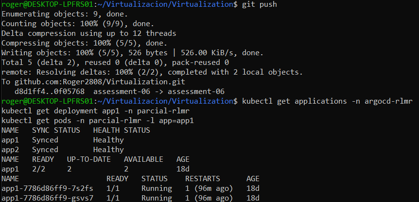
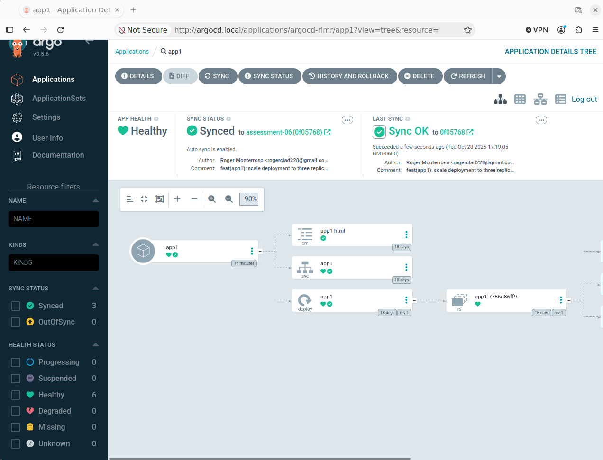

# Argo CD GitOps Deployment on Kubernetes

## Overview

This project demonstrates GitOps deployment and continuous reconciliation using Argo CD on a local Minikube Kubernetes cluster. Argo CD monitors a GitHub repository and automatically applies changes to the Kubernetes resources defined in Git.

The deployment uses the existing Traefik ingress controller to expose the applications and the Argo CD web interface through local domains.

## Architecture

- **Kubernetes:** Minikube
- **GitOps controller:** Argo CD
- **Ingress controller:** Traefik
- **Container image:** Nginx `1.27`
- **Source repository:** `https://github.com/Roger2808/Virtualization`
- **Branch:** `assessment-06`
- **Application namespace:** `parcial-rlmr`
- **Argo CD namespace:** `argocd-rlmr`

### Local domains

| Domain | Purpose |
|---|---|
| `app1.local` | Application 1 |
| `app2.local` | Application 2 |
| `app3.local` | Application 3 |
| `app4.local` | Application 4 |
| `argocd.local` | Argo CD web interface |

The domains route through Traefik's LoadBalancer IP, `192.168.49.240`.

## Prerequisites

- A working Minikube cluster with `kubectl` configured.
- Traefik installed and reachable through its LoadBalancer IP.
- Git and access to the GitHub repository.
- Local host resolution configured for the application domains.

Verify the active Kubernetes context:

```bash
kubectl config current-context
```

The expected context is `minikube`.

## 1. Install Argo CD

Create the dedicated namespace:

```bash
kubectl apply -f argocd/namespace.yaml
```

Apply the Argo CD installation manifest to the correct namespace:

```bash
kubectl apply -n argocd-rlmr \
  --server-side --force-conflicts \
  -f argocd/install.yaml
```

Wait for the server to become available:

```bash
kubectl rollout status deployment/argocd-server \
  -n argocd-rlmr --timeout=180s
```

Verify the components:

```bash
kubectl get pods -n argocd-rlmr
```

## 2. Expose Argo CD through Traefik

Configure Argo CD to serve HTTP behind the local Traefik ingress:

```bash
kubectl apply -f argocd/argocd-cmd-params-cm.yaml
kubectl apply -f argocd/ingressroute.yaml
kubectl rollout restart deployment/argocd-server -n argocd-rlmr
kubectl rollout status deployment/argocd-server \
  -n argocd-rlmr --timeout=180s
```

The IngressRoute maps `argocd.local` to the `argocd-server` service on port 80.

### Configure local host resolution

Add the following entries to the hosts file on each environment where the domains need to resolve.

For WSL/Linux, edit `/etc/hosts`:

```text
192.168.49.240 app1.local
192.168.49.240 app2.local
192.168.49.240 app3.local
192.168.49.240 app4.local
192.168.49.240 argocd.local
```



For the Windows browser, add the same entries to:

```text
C:\Windows\System32\drivers\etc\hosts
```

Open the file with administrator privileges to save changes.

### WSL networking note

During setup, an additional route was required to reach Traefik's LoadBalancer IP from WSL. The observed route was:

```text
192.168.49.240 via 192.168.49.2 dev br-73ee8a88e281
```

The corresponding command used for this environment was:

```bash
sudo ip route add 192.168.49.240/32 \
  via 192.168.49.2 dev br-73ee8a88e281
```

The bridge interface and gateway are environment-specific. Check the current route before adding it:

```bash
ip route get 192.168.49.240
ip route | grep 192.168.49
```

If the route already exists, do not add it again. This route may need to be recreated if the WSL networking configuration changes.

### Access the interface

Open:

`http://argocd.local`

The initial administrator username is `admin`. Retrieve the initial password from the Kubernetes secret:

```bash
kubectl get secret argocd-initial-admin-secret \
  -n argocd-rlmr \
  -o jsonpath='{.data.password}' | base64 -d
echo
```

Change the initial password after logging in.

## 3. Configure GitOps applications

The Argo CD Application manifests are stored in `argocd/applications/`.

Both applications use the following source configuration:

- Repository: `https://github.com/Roger2808/Virtualization.git`
- Target revision: `assessment-06`
- Destination cluster: `https://kubernetes.default.svc`
- Destination namespace: `parcial-rlmr`

| Application | Git path | Initial replicas |
|---|---|---:|
| `app1` | `apps/app1` | 2 |
| `app2` | `apps/app2` | 2 |

Create the Argo CD applications:

```bash
kubectl apply -f argocd/applications/
```

Argo CD is configured for automated synchronization, pruning, and self-healing.

Verify their status:

```bash
kubectl get applications -n argocd-rlmr
```

Check synchronization and health:

```bash
kubectl get applications -n argocd-rlmr \
  -o custom-columns='NAME:.metadata.name,SYNC:.status.sync.status,HEALTH:.status.health.status'
```

The expected final status is `Synced` and `Healthy` for both applications.

## 4. GitOps synchronization test

The synchronization test demonstrated that changes committed to Git are automatically reconciled by Argo CD.

### Initial state

The `app1` Deployment initially specified two replicas:

```yaml
spec:
  replicas: 2
```

### Change committed to Git

The replica count was changed to three in `apps/app1/deployment.yaml` and pushed to the `assessment-06` branch.

The commit was:

```text
0f05768 feat(app1): scale deployment to three replicas
```

### Verification

After Argo CD reconciled the repository, Kubernetes reported three available replicas:

```bash
kubectl get deployment app1 -n parcial-rlmr
kubectl get pods -n parcial-rlmr -l app=app1
```

Expected Deployment status:

```text
NAME   READY   UP-TO-DATE   AVAILABLE
app1   3/3     3            3
```

Argo CD continued to report `app1` as `Synced` and `Healthy`. The `app2` Deployment remained at two replicas.

## 5. Evidence

Screenshots captured during installation and validation are stored in `docs/`.

### Initial Argo CD state







### After the GitOps change






