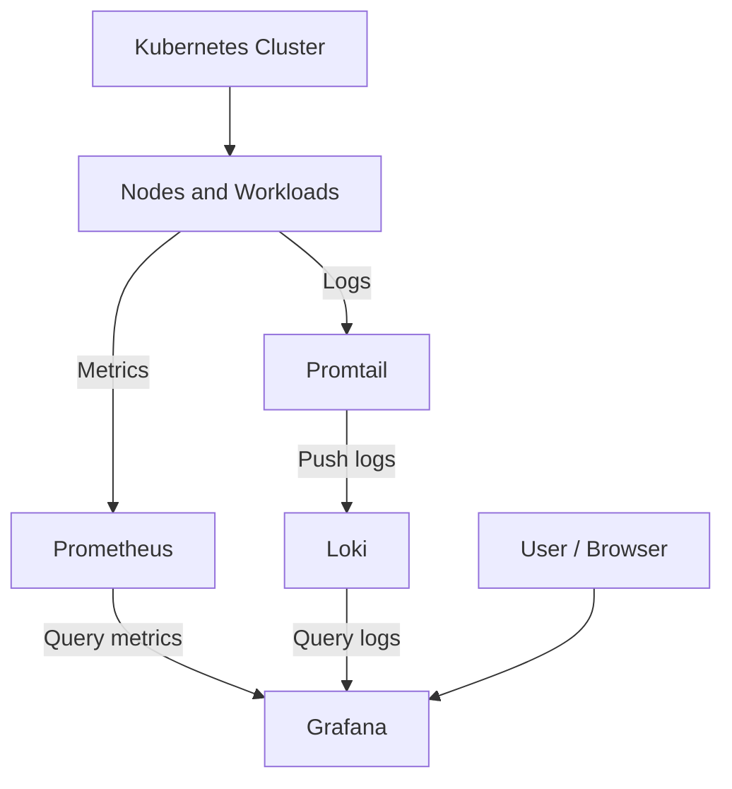
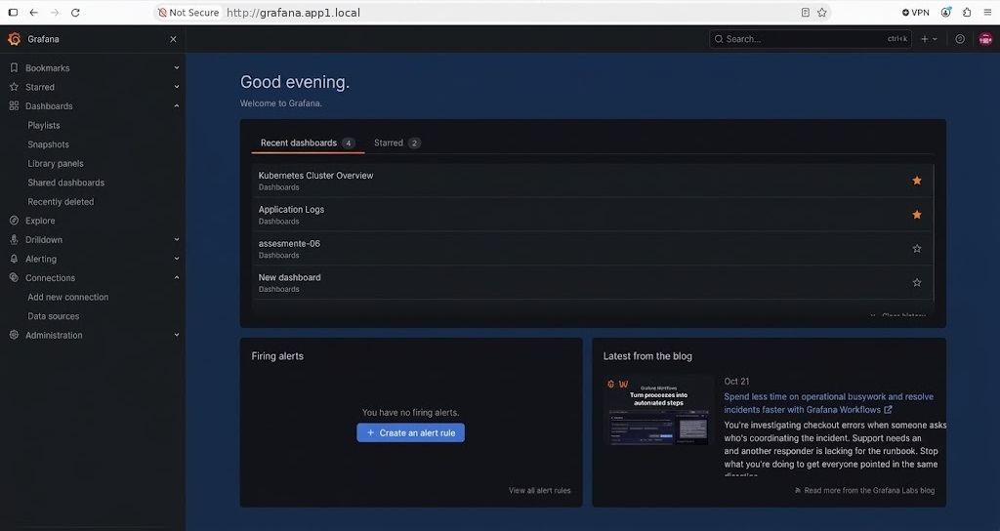
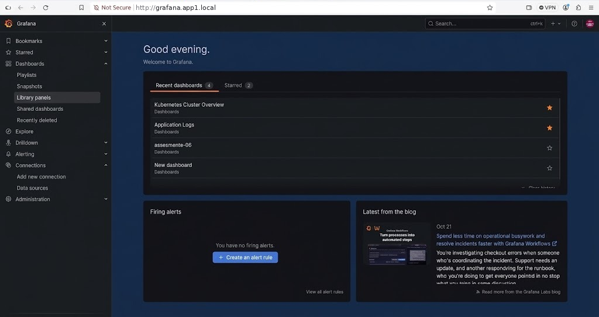
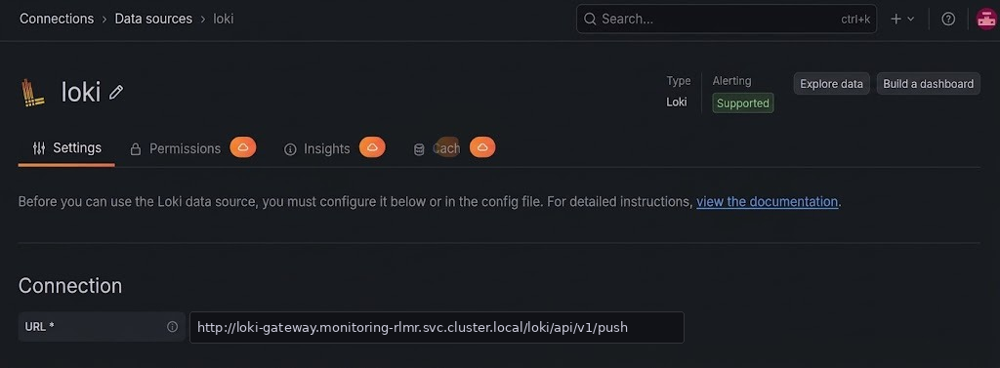
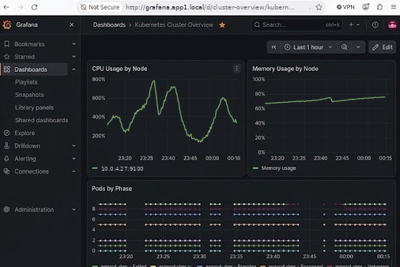

# Kubernetes Monitoring and Logging

## Overview

This project implements a monitoring and logging stack for a Kubernetes cluster using Prometheus, Grafana, Loki, and Promtail.

Prometheus collects metrics from the configured monitoring targets, Grafana provides dashboards for data visualization, and Loki with Promtail enables centralized log collection and exploration. Together, these tools provide visibility into cluster resources, workload health, and application activity.

The solution runs in a local Kubernetes environment and uses Kubernetes resources and persistent storage to support the monitoring services.

## Objectives

- Deploy a monitoring and logging stack on Kubernetes.
- Collect and visualize cluster and workload metrics.
- Centralize application logs using Loki and Promtail.
- Configure Grafana to query Prometheus and Loki.
- Explore monitoring dashboards and application logs through Grafana.
- Validate the availability of monitoring components and their Kubernetes Services.

## Architecture



## Technology Stack

| Technology | Purpose |
|---|---|
| Kubernetes | Container orchestration and resource management |
| Minikube | Local Kubernetes environment |
| Prometheus | Metrics collection and storage |
| Grafana | Dashboards and data visualization |
| Loki | Log aggregation and querying |
| Promtail | Log collection and forwarding |
| Helm | Installation and management of packaged Kubernetes applications |
| kubectl | Kubernetes administration and troubleshooting |

## Kubernetes Environment

The monitoring stack runs in the `monitoring-rlmr` namespace.

The main components include:

- Grafana for metrics and log visualization.
- Prometheus for metrics collection.
- Loki for log storage and querying.
- Promtail for log collection.
- Supporting monitoring components, including Kubernetes State Metrics and the Prometheus Operator.

Check the deployed resources:

```bash
kubectl get pods,services -n monitoring-rlmr -o wide
```

Inspect persistent volume claims:

```bash
kubectl get pvc -n monitoring-rlmr
```

Persistent storage helps retain monitoring data across pod replacements, depending on each component's storage configuration.

## Monitoring with Prometheus

Prometheus collects metrics from configured Kubernetes monitoring targets. These metrics provide information about cluster resources and workload behavior.

The collected data can be queried and visualized through Grafana dashboards.

Check Prometheus-related resources:

```bash
kubectl get pods,services -n monitoring-rlmr | grep prometheus
```

To troubleshoot collection issues, inspect the Prometheus pod logs and verify that the configured scrape targets are reachable.

## Visualization with Grafana

Grafana provides a centralized interface for visualizing monitoring data. It can query Prometheus for metrics and Loki for log data.

The configured dashboards support cluster monitoring and log exploration.

### Grafana interface

The following screenshots document the Grafana interface in the monitoring environment.





## Log Aggregation with Loki and Promtail

Loki stores and indexes log metadata, allowing users to query logs without requiring a full-text index of every log line. Promtail collects logs from configured sources and forwards them to Loki.

This integration allows users to investigate application behavior and troubleshoot workloads from Grafana.

### Loki data source

The following screenshot documents the Loki data source configuration in Grafana.



### Integrated log visualization

Grafana can query Loki to explore log entries alongside other monitoring information.



## Deployment Verification

### Check monitoring workloads

```bash
kubectl get pods -n monitoring-rlmr -o wide
```

Verify that the required pods are running and ready.

### Check Services and endpoints

```bash
kubectl get services,endpoints -n monitoring-rlmr
```

Services should have appropriate endpoints when their selected workloads are ready.

### Inspect component logs

Grafana:

```bash
kubectl logs -n monitoring-rlmr deploy/grafana --all-containers=true --tail=100
```

To inspect Prometheus, Loki, or Promtail, first identify the corresponding pod:

```bash
kubectl get pods -n monitoring-rlmr
```

Then retrieve its logs:

```bash
kubectl logs -n monitoring-rlmr <pod-name> --tail=100
```

### Check Kubernetes events

```bash
kubectl get events -n monitoring-rlmr --sort-by=.lastTimestamp
```

Events can help identify failed probes, scheduling issues, storage problems, and container restarts.

### Check resource metrics

```bash
kubectl top pods -n monitoring-rlmr
```

This command requires the Kubernetes Metrics API to be available. If the API is unavailable, use other available diagnostics to inspect resource consumption.

## Troubleshooting

### Grafana is unavailable

1. Check the Grafana pod status.
2. Verify that the Grafana Service has endpoints.
3. Inspect the pod logs.
4. Check the network route and ingress configuration, if applicable.
5. Review recent Kubernetes events.

### Metrics are missing

1. Verify that Prometheus is running.
2. Inspect the configured scrape targets.
3. Check connectivity between Prometheus and its targets.
4. Confirm that Grafana's Prometheus data source uses the correct Service address.

### Logs are missing in Grafana

1. Verify that Loki is running.
2. Check Promtail pod status and logs.
3. Confirm that Promtail can reach the Loki Service.
4. Verify the Loki data source configuration in Grafana.
5. Review the query and label filters used in Grafana.

### Persistent storage issues

Inspect the persistent volume claims:

```bash
kubectl get pvc -n monitoring-rlmr
```

Review pod events and storage configuration before making changes. Avoid deleting persistent volume claims because doing so may result in data loss.

## Security and Maintenance

- Avoid committing credentials or sensitive configuration to version control.
- Preserve persistent monitoring data during maintenance.
- Review pod logs, events, and resource consumption before restarting components.
- Keep monitoring data retention appropriate for the available storage.
- Validate changes to dashboards, data sources, and collection configuration before applying them to the cluster.

## Conclusion

This project provides a Kubernetes monitoring and logging environment based on Prometheus, Grafana, Loki, and Promtail.

Prometheus supplies metrics, Loki centralizes logs, Promtail forwards log data, and Grafana combines these sources into a unified visualization interface. This setup supports infrastructure monitoring, application troubleshooting, and operational analysis within a local Kubernetes cluster.
